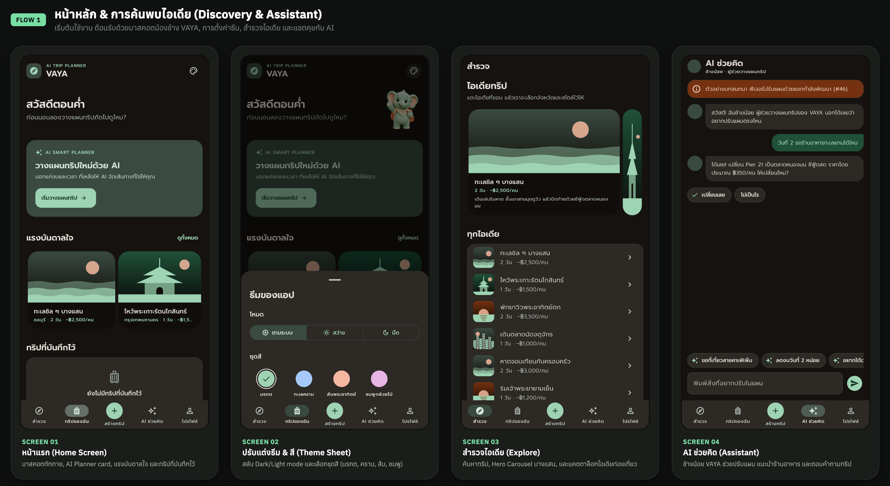
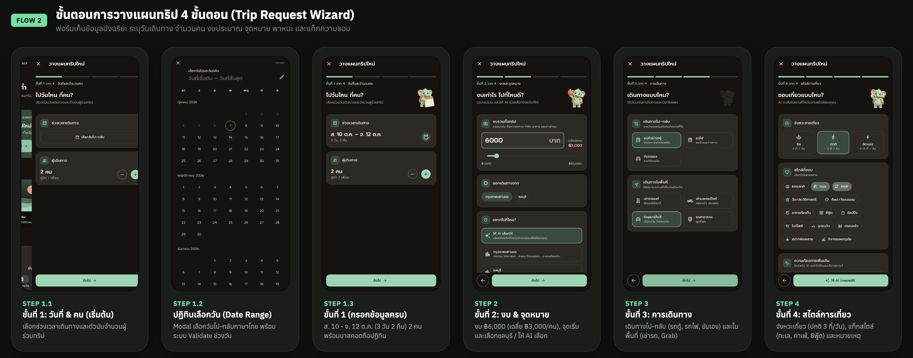
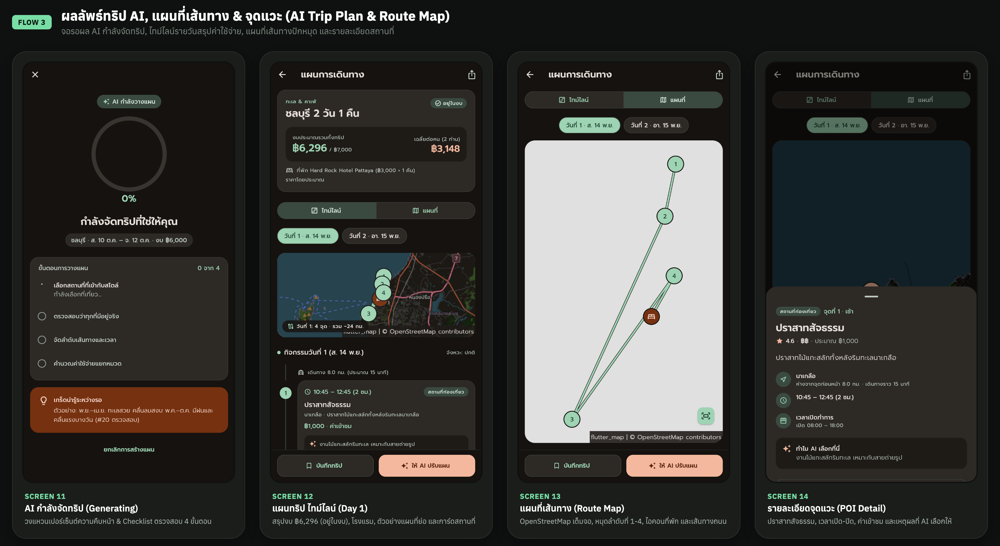
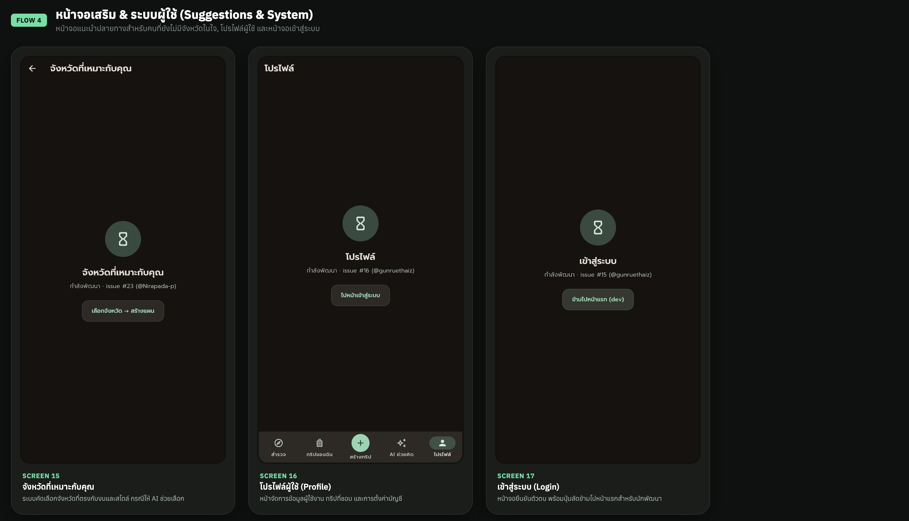

<div align="center">


# VAYA: AI Trip Planner

**บอกแค่ "มีเวลาเท่านี้ มีงบเท่านี้ อยากเที่ยวแบบนี้" แล้ว VAYA จัดทริปในไทยให้ทั้งทริป**

[](https://github.com/VAYA-App/VAYA-App/actions/workflows/ci.yml)
[](https://github.com/VAYA-App/VAYA-App/releases/latest)
[](LICENSE)


</div>

แอปวางแผนเที่ยวในประเทศไทย ผู้ใช้กรอกวันที่ งบ จำนวนคน และสไตล์ที่ชอบ แล้วระบบจะเสนอจังหวัดที่เหมาะ สร้างแผนรายวัน คำนวณค่าใช้จ่ายแยกหมวด และแสดงเป็นไทม์ไลน์กับแผนที่ ถ้าแผนเกินงบ ระบบบอกว่าเกินเท่าไรและแนะนำวิธีลดค่าใช้จ่าย

## สารบัญ

- [ภาพหน้าจอ](#ภาพหน้าจอ)
- [ฟีเจอร์](#ฟีเจอร์)
- [เทคโนโลยี](#เทคโนโลยี)
- [สถาปัตยกรรม](#สถาปัตยกรรม)
- [เริ่มต้นใช้งาน](#เริ่มต้นใช้งาน)
- [การทดสอบและ CI](#การทดสอบและ-ci)
- [สถานการณ์สำหรับ Demo](#สถานการณ์สำหรับ-demo)
- [เอกสาร](#เอกสาร)
- [ทีม](#ทีม)
- [License](#license)

## ภาพหน้าจอ

| ค้นหาไอเดียและผู้ช่วย AI | ฟอร์มวางแผนทริป 4 ขั้น |
|---|---|
|  |  |
| **แผนทริปจาก AI และแผนที่** | **คำแนะนำจังหวัด โปรไฟล์ และระบบ** |
|  |  |

## ฟีเจอร์

- **เข้าสู่ระบบ** ด้วยบัญชี Google ผ่าน Firebase Auth
- **ฟอร์ม Trip Request 4 ขั้น**: วันที่, งบและจำนวนคน, วิธีเดินทาง, สไตล์การเที่ยว (ถ้าต้นทางกับปลายทางเป็นจังหวัดเดียวกัน ฟอร์มข้ามขั้นเดินทางข้ามเมืองให้)
- **แนะนำจังหวัด** จาก 8 จังหวัด (กรุงเทพฯ, ชลบุรี, เชียงใหม่, พระนครศรีอยุธยา, ภูเก็ต, กระบี่, กาญจนบุรี, ประจวบคีรีขันธ์) กรองด้วยงบก่อน แล้วให้ Gemini จัดอันดับตามความชอบ
- **สร้างแผนรายวัน**: Gemini เลือกสถานที่ลงแต่ละช่วงเวลา ส่วนโค้ดจัดลำดับเส้นทาง เวลาแต่ละจุด และที่พัก
- **คำนวณค่าใช้จ่าย** แยกหมวด (เดินทางข้ามเมือง, เดินทางในเมือง, ที่พัก, อาหาร, ค่าเข้าชม, เผื่อ) แบบ deterministic
- **Over Budget**: บอกยอดที่เกินพร้อมคำแนะนำ 2–3 ข้อ
- **ไทม์ไลน์และแผนที่** OpenStreetMap ปักหมุดทุกจุด เปิดนำทางใน Google Maps ได้ และดูพยากรณ์อากาศ
- **ให้ AI ปรับแผน** ผ่านแชท เช่น "เปลี่ยนร้านมื้อเย็นเป็นซีฟู้ด"
- **บันทึกทริป** ลง Firestore แยกตามผู้ใช้ (ถ้า Firebase ไม่พร้อมจะเก็บในเครื่องด้วย Hive) เปิดดูซ้ำหรือลบได้จากแท็บทริปของฉัน
- **แชร์แผน** เป็นข้อความ หรือส่งออกเป็นไฟล์ปฏิทิน `.ics`
- **ใช้งานได้แม้ไม่มี Gemini**: ทุกขั้นที่ใช้ AI มี fallback ที่คำนวณด้วยโค้ด
- **Material 3** รองรับ light/dark, ขนาดจอ compact/expanded และตัวอักษรใหญ่ 200%

## เทคโนโลยี

| ส่วน | ใช้ |
|---|---|
| แอป | Flutter 3.44 (Dart 3.12), Material 3, Riverpod, go_router |
| AI | Gemini ผ่าน REST (`lib/ai/`) |
| ผู้ใช้และข้อมูลผู้ใช้ | Firebase Auth (Google Sign-In), Cloud Firestore |
| เก็บในเครื่อง | Hive CE |
| แผนที่และเส้นทาง | flutter_map + OpenStreetMap, OSRM |
| อากาศ | Open-Meteo |
| ข้อมูลจังหวัดและสถานที่ | ไฟล์ JSON และรูปใน `assets/` (ใช้ได้ตอนออฟไลน์) |
| CI | GitHub Actions: lint, unit, widget, integration (Android emulator), Firestore rules, coverage, build |

## สถาปัตยกรรม

หลักสำคัญคือ **Gemini เป็นผู้เลือก ส่วนโค้ดเป็นผู้คำนวณ** ([ADR-0001](docs/adr/0001-gemini-selects-code-computes.md)) Gemini ส่ง JSON ที่อ้างอิงสถานที่ด้วย ID ที่มีอยู่จริงเท่านั้น ราคา เส้นทาง และการตัดสินว่าเกินงบคำนวณใน Dart ทั้งหมด จึงเขียน unit test ได้และไม่มีสถานที่ที่ AI แต่งขึ้นเอง

```
Trip Request ─▶ Province Filter ─▶ Destination Suggester ─▶ Place Selector ─▶ Route Orderer
   (ฟอร์ม)        (กรองด้วยงบ)        (Gemini จัดอันดับ)        (Gemini เลือก)     (โค้ดจัดลำดับ)
                                                                                     │
          Trip Plan ◀─ Over Budget Advisor ◀─ Cost Calculator ◀─ Night Stay Planner ◀┘
```

```
lib/
├── app/        ธีม, router, layout ตามขนาดจอ, providers
├── domain/     model ของโดเมน (Trip Request, Trip Plan, Place, Cost Estimate, …)
├── planner/    pipeline การวางแผนและตัวคำนวณ (ไม่พึ่ง Flutter)
├── ai/         GeminiService, prompt และ mock
├── data/       repository: สถานที่, ราคา, ทริป (Firestore/Hive), auth, เส้นทาง, อากาศ
├── features/   หน้าจอแต่ละฟีเจอร์
└── shared/     widget ที่ใช้ร่วมกัน
```

ศัพท์ของโดเมนอยู่ใน [CONTEXT.md](CONTEXT.md) และเหตุผลของการตัดสินใจอยู่ใน [docs/adr/](docs/adr/)

## เริ่มต้นใช้งาน

### ติดตั้ง APK (Android)

โหลด `vaya-*.apk` จาก [Releases](https://github.com/VAYA-App/VAYA-App/releases/latest) แล้วติดตั้งบนเครื่อง Android (ต้องเปิดให้ติดตั้งแอปจากแหล่งที่ไม่รู้จัก)

### รันจากซอร์สโค้ด

ต้องมี Flutter 3.44 ขึ้นไป และ Android Studio หรือ Xcode

```bash
git clone https://github.com/VAYA-App/VAYA-App.git
cd VAYA-App
flutter pub get
flutter run
```

### เปิดใช้ Gemini จริง

ถ้าไม่ใส่ key แอปใช้ mock และทุกขั้นที่ใช้ AI จะใช้ fallback ที่คำนวณด้วยโค้ดแทน ถ้าจะใช้ Gemini จริง:

1. สร้าง API key ที่ [Google AI Studio](https://aistudio.google.com/apikey) แล้วจำกัดให้ใช้ได้เฉพาะ Generative Language API
2. copy `env.example.json` เป็น `env.json` แล้วใส่ key (`env.json` อยู่ใน `.gitignore` ห้าม commit)
3. รันด้วย

```bash
flutter run --dart-define-from-file=env.json
```

key จะถูกฝังอยู่ในแอป ใช้สำหรับ demo เท่านั้น

### ดู UI ใน Chrome (ไม่ต้องมี simulator)

```bash
flutter run -d chrome
```

ลากย่อขยายหน้าต่างเพื่อทดสอบขนาดจอตาม M3: แคบกว่า 600px = compact (มือถือ), 840px ขึ้นไป = expanded (แท็บเล็ตแนวนอน) ส่วน web มีไว้ดู UI ระหว่างพัฒนาเท่านั้น แอปจริงคือ Android + iOS

## การทดสอบและ CI

```bash
flutter analyze
flutter test
flutter test integration_test/trip_flow_test.dart -d <device>
```

ทุก PR เข้า `main` และทุก commit บน `main` ผ่าน GitHub Actions เป็นขั้น ๆ: lint → test (unit, widget, integration บน Android emulator, Firestore security rules) → coverage ≥ 70% → build web และ Android รายละเอียดอยู่ใน [docs/TESTING.md](docs/TESTING.md)

## สถานการณ์สำหรับ Demo

1. เสาร์–อาทิตย์ 2 วัน 1 คืน งบ 6,000 บาท 2 คน ออกจากกรุงเทพฯ ชอบทะเลกับคาเฟ่ เที่ยวแบบชิล → ชลบุรี
2. เที่ยวในกรุงเทพฯ 1 วัน งบ 1,500 บาท 1 คน สายวัดกับประวัติศาสตร์
3. ชลบุรี 3 วัน 2 คืน งบ 3,000 บาท 4 คน → Over Budget

ทั้ง 3 สถานการณ์เป็น test ใน [`test/planner/demo_scenarios_test.dart`](test/planner/demo_scenarios_test.dart) (รันผ่าน pipeline จริงกับข้อมูลใน `assets/data/` แทนแค่ Gemini ด้วยคำตอบจาก `test/fixtures/`)

| | ค่าที่กรอก | ผลที่ต้องได้ |
|---|---|---|
| 1 | 14–15 พ.ย. 2026 · กทม→ชลบุรี · รถทัวร์ · รถสาธารณะ · ทะเล, คาเฟ่ · ชิล | แผน 2 วัน 1 คืนจากที่ Gemini เลือก อยู่ในงบ |
| 2 | 14 พ.ย. 2026 · กทม→กทม · รถสาธารณะ · วัด/ประวัติศาสตร์ · ปกติ | ไม่มีขาเดินทางข้ามเมือง (ค่าเดินทางข้ามเมือง 0) ไม่มีที่พัก อยู่ในงบ |
| 3 | 14–16 พ.ย. 2026 · กทม→ชลบุรี · รถทัวร์ · แท็กซี่ · ทะเล, ซีฟู้ด · ชิล | Over Budget พร้อมคำแนะนำ 2–3 ข้อ (ใช้ fallback แทน Gemini เหมือนตอน Gemini ล่ม) |

รันเฉพาะชุดนี้: `flutter test test/planner/demo_scenarios_test.dart`

## เอกสาร

| เอกสาร | อ่านเมื่อ |
|---|---|
| [docs/SPRINT-2W.md](docs/SPRINT-2W.md) | scope, ใครทำอะไร, ตารางรายวัน |
| [CONTRIBUTING.md](CONTRIBUTING.md) | ก่อนแตก branch หรือเปิด PR ครั้งแรก |
| [docs/DESIGN.md](docs/DESIGN.md) | ก่อนทำหน้าจอใด ๆ (Material 3 เท่านั้น) |
| [CONTEXT.md](CONTEXT.md) | ศัพท์ของโดเมน (Trip Request, Stop, Night Stay, …) |
| [docs/PROJECT-PLAN.md](docs/PROJECT-PLAN.md) | schema, สูตรราคา, pipeline |
| [docs/DATA.md](docs/DATA.md) | ข้อมูลจังหวัด สถานที่ และราคา |
| [docs/adr/](docs/adr/) | เหตุผลของการตัดสินใจสำคัญ |
| [docs/TESTING.md](docs/TESTING.md) | ชนิดของ test, coverage และ CI |
| [docs/USABILITY-TEST.md](docs/USABILITY-TEST.md) | แผนและผล Usability Testing |
| [CHANGELOG.md](CHANGELOG.md) | สิ่งที่เปลี่ยนในแต่ละเวอร์ชัน |

## ทีม

| GitHub | รับผิดชอบ |
|---|---|
| [@Kritternai](https://github.com/Kritternai) (หัวหน้าทีม) | โครงโปรเจกต์ + Firebase, ฟอร์ม Trip Request, สร้าง Trip Plan + GeminiService, ไทม์ไลน์และแผนที่ |
| [@tp-job](https://github.com/tp-job) | Cost Estimate, Over Budget |
| [@Nirapada-p](https://github.com/Nirapada-p) | Destination Suggestion, ข้อมูลจังหวัดและสถานที่ |
| [@gunruethaiz](https://github.com/gunruethaiz) | ล็อกอิน + Profile, บันทึกและรายการทริป |

## License

โค้ดเผยแพร่ภายใต้ [MIT License](LICENSE)

License นี้ไม่ครอบคลุมเนื้อหาของบุคคลอื่นที่รวมอยู่ในแอป ซึ่งยังเป็นไปตามเงื่อนไขของเจ้าของเดิม:

- รูปสถานที่ใน `assets/photos/`: ที่มา ผู้ถ่าย และ license ของแต่ละรูปอยู่ใน [`assets/photos/credits.json`](assets/photos/credits.json) และหน้า "เครดิตภาพ" ในแอป บางรูปไม่ทราบ license จึงใช้ได้เฉพาะงาน demo ([ADR-0006](docs/adr/0006-bundle-place-photos-with-license-manifest.md))
- ฟอนต์ Prompt: [SIL Open Font License](assets/fonts/OFL.txt)
- แผนที่: © ผู้ร่วมพัฒนา [OpenStreetMap](https://www.openstreetmap.org/copyright)
