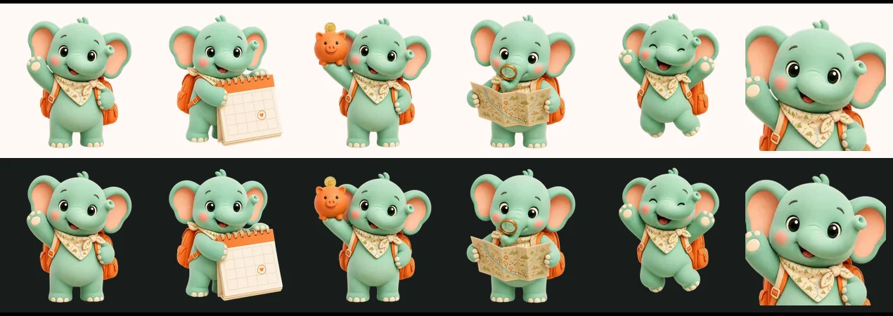

# มาสคอต: ช้างน้อย



ช้างน้อยนักเดินทางคือเพื่อนร่วมทางในแอป โผล่ตามจังหวะสำคัญ เช่น ทักทาย ช่วยกรอกฟอร์ม รอ AI วางแผน และดีใจเมื่อแผนเสร็จ เพื่อให้แอปดูเป็นมิตรและเข้าถึงง่าย งานทั้งหมดอยู่ใน epic #77

## หน้าตา

- ช้างเด็กตัวกลม ผิวสีเขียวมินต์ หูด้านในและแก้มสีชมพูพีช ตาโตเป็นประกาย
- สะพายเป้สีส้มพระอาทิตย์ตก และผูกผ้าพันคอสีครีมลายแผนที่
- สไตล์ตุ๊กตา 3D เนื้อด้าน แสงสตูดิโอนุ่ม ๆ
- บุคลิก: ร่าเริง อยากรู้อยากเห็น ชอบช่วย ไม่ตื่นตูม

## ท่าที่มี (`assets/mascot/`)

| ไฟล์ | ท่า | ใช้ที่ไหน |
|---|---|---|
| `wave` | โบกมือทักทาย | หน้าแรก, empty state (ชั่วคราว), ฟอร์มขั้นความชอบ |
| `calendar` | กอดปฏิทิน | ฟอร์มขั้นวันที่และจำนวนคน |
| `budget` | ชูกระปุกออมสิน | ฟอร์มขั้นงบ, banner เกินงบ (ชั่วคราว) |
| `map` | ส่องแผนที่ | หน้า Generating, ฟอร์มขั้นวิธีเดินทาง, error (ชั่วคราว) |
| `celebrate` | กระโดดดีใจ | แผนเสร็จ |
| `avatar` | หน้าและไหล่ (ครอปจาก `wave`) | รูปของผู้ช่วย AI |

ท่าที่ยังขาด (#86): `worried` (เกินงบ), `rainy` (error/ออฟไลน์), `waiting` (empty state)

ทุกไฟล์เป็น WebP พื้นโปร่งใส ครอปด้วยกรอบเดียวกัน ตัวช้างจึงมีขนาดเท่ากันทุกท่า มีไฟล์ 3 ขนาดให้ Flutter เลือกตามความละเอียดจอ:

| ไฟล์ | ขนาดที่ 1x | 2.0x | 3.0x |
|---|---|---|---|
| ท่าทั้งหมด | 240×240 | 480×480 | 720×720 |
| `avatar` | 96×96 | 192×192 | 288×288 |

## กติกาการใช้ (ต้องผ่านก่อน merge)

- **เป็นของตกแต่งเท่านั้น:** ข้อมูลสำคัญต้องมีข้อความและไอคอนครบเสมอ ห่อด้วย `ExcludeSemantics` เพื่อไม่ให้ screen reader อ่าน
- **เคารพการปิดแอนิเมชัน:** ถ้า `MediaQuery.disableAnimationsOf(context)` เป็นจริง ให้แสดงภาพนิ่งและห้ามหน่วงการเปลี่ยนหน้า
- **ไม่แย่งพื้นที่ข้อความ:** จำกัดขนาดสูงสุด และซ่อนมาสคอตเมื่อตัวอักษรใหญ่จนพื้นที่ไม่พอ
- **หน้าละ 1 ตัว:** อย่าวางมาสคอตหลายตัวในหน้าเดียว
- **ไม่แก้สีของภาพ:** ภาพมีสีของตัวเอง จึงไม่ผูกกับธีม ให้วางบนพื้น `surface` หรือ `*Container` ของธีม (ดูดีทั้งโหมดสว่างและโหมดมืด)
- ใช้ผ่าน `MascotView` (#79) เท่านั้น ห้ามเรียก `Image.asset` เอง เพื่อให้กติกาด้านบนทำงานทุกที่

## ทำท่าใหม่

ภาพสร้างด้วย Canva AI (generate image) แล้วทำพื้นโปร่งใสด้วยสคริปต์ในโปรเจกต์

1. **สร้างภาพ:** ใช้ `assets/mascot/3.0x/wave.webp` เป็นภาพอ้างอิง (image reference) แล้วใช้ prompt ด้านล่าง เปลี่ยนแค่ส่วน "New pose"
2. **ลบพื้นหลัง:** ใช้ Remove background ใน Canva
3. **วางลงหน้า 1080×1080 สองชุด:** ชุดแรกพื้นขาว อีกชุดใส่สี่เหลี่ยมสีดำเต็มหน้าไว้ด้านหลังภาพ วางภาพเต็มหน้า (top 0, left 0, 1080×1080)
4. **Export เป็น PNG ทั้งสองชุด:** ตั้งชื่อไฟล์ตามท่า แล้วเก็บไว้ใน `white/` และ `black/`
5. **รันสคริปต์:** `python3 tool/mascot/matte.py white black` (ต้องมี Pillow และ NumPy) สคริปต์จะใช้ความต่างระหว่างพื้นขาวกับพื้นดำคำนวณความโปร่งใสที่แม่นยำ แล้วครอปทุกท่าด้วยกรอบเดียวกัน **ต้องใส่ทุกท่า (ทั้งเก่าและใหม่) ในโฟลเดอร์ทุกครั้ง** ไม่งั้นกรอบจะเปลี่ยนและขนาดช้างจะไม่เท่ากัน

Prompt ต้นแบบ:

```text
Use the reference image character exactly: the same cute 3D mint-emerald baby
elephant mascot with big glossy eyes, rosy cheeks, orange backpack and cream
map-print scarf, same proportions, materials, soft studio lighting and
Pop Mart / Pixar toy render style. New pose: <อธิบายท่า>. Full body, centered,
generous empty space, plain solid off-white background (#FFF8F5), no text.
```

ไฟล์ต้นฉบับอยู่ในดีไซน์ Canva "VAYA mascot poses" ของ @Kritternai
