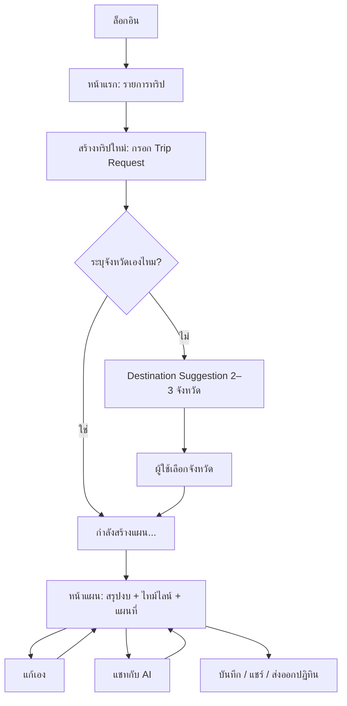
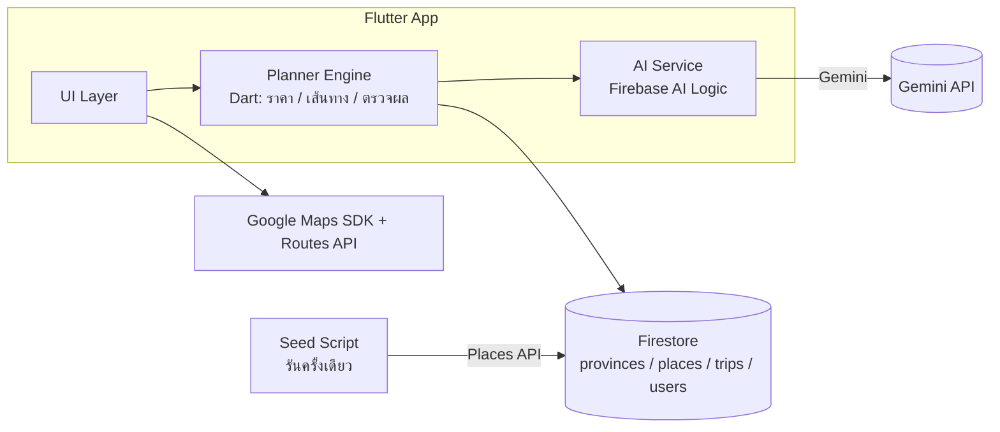
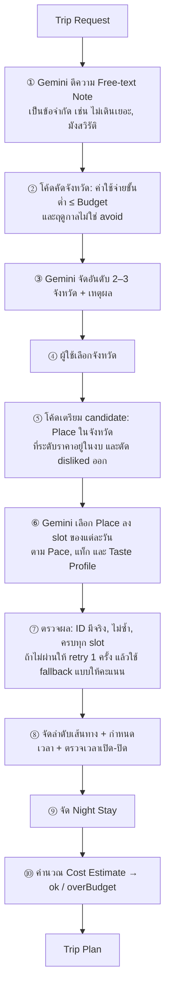

# แผนโปรเจกต์: AI Trip Planner

> แอปวางแผนการท่องเที่ยวอัจฉริยะ ผู้ใช้บอกแค่ว่า **"มีเวลาเท่านี้ มีงบเท่านี้ อยากเที่ยวแบบนี้"** แล้วระบบจะเสนอจังหวัด สร้างแผนรายวัน คำนวณค่าใช้จ่าย จัดลำดับเส้นทาง และแสดงผลเป็นไทม์ไลน์กับแผนที่
>
> ศัพท์ที่ใช้ในเอกสารนี้ (Trip Request, Trip Plan, Stop, …) นิยามไว้ใน [CONTEXT.md](../CONTEXT.md)
> เหตุผลของการตัดสินใจสำคัญบันทึกไว้ใน [docs/adr/](./adr/)

> ⚠️ **อัปเดต 2 ต.ค. 2569:** ขอบเขต จังหวัด ตารางเวลา และการแบ่งงานที่ใช้จริงอยู่ใน [SPRINT-2W.md](./SPRINT-2W.md) ส่วนเอกสารนี้ใช้อ้างอิงเรื่อง schema สูตรราคา และ pipeline

---

## 1. ข้อมูลโปรเจกต์

| หัวข้อ | รายละเอียด |
|---|---|
| ทีม | 4 คน |
| ระยะเวลา | 4–5 สัปดาห์ |
| แพลตฟอร์ม | Flutter (Android และ iOS) |
| Backend | Firebase: Auth, Firestore และ Firebase AI Logic |
| AI | **Gemini** (อาจารย์กำหนด) เรียกผ่าน Firebase AI Logic จึงไม่มี API key อยู่ในแอป |
| แผนที่ | Google Maps SDK for Flutter, Places API (New) (ใช้ตอน seed ข้อมูลเท่านั้น), Routes API (ใช้วาดเส้นทาง) |
| ขอบเขตพื้นที่ | ประเทศไทย เริ่มจาก 5–8 จังหวัด |
| ภาษาในแอป | ไทย |

## 2. ขอบเขตงาน

### ทำ
- ผู้ใช้กรอก Trip Request ได้โดยไม่ต้องระบุจังหวัด (หรือจะระบุเองก็ได้)
- ระบบเสนอ 2–3 จังหวัด พร้อมเหตุผลและงบประมาณคร่าว ๆ
- สร้าง Trip Plan หนึ่งจังหวัดต่อหนึ่งทริป ประกอบด้วย ที่พัก ร้านอาหาร และสถานที่ท่องเที่ยว
- คำนวณ Cost Estimate แยกหมวด พร้อมยอดต่อคน
- จัดลำดับเส้นทางในแต่ละวัน แล้วแสดงเป็นไทม์ไลน์และแผนที่
- แก้แผนเองหรือสั่งแก้ผ่านแชทกับ AI ก็ได้
- บันทึกแผน ดูแผนย้อนหลัง และเรียนรู้จาก 👍/👎

### ไม่ทำในรอบนี้
- การจองหรือชำระเงินจริง
- ทริปหลายจังหวัด
- ราคาเรียลไทม์ (ใช้ราคาประมาณจาก Price Level แทน)
- การแก้แผนร่วมกันหลายคน และหน้าเว็บสำหรับเปิดลิงก์แชร์

### จังหวัดที่รองรับในช่วงแรก (ร่าง)
เชียงใหม่ · ภูเก็ต · กระบี่ · กาญจนบุรี · ประจวบคีรีขันธ์ (หัวหิน) · พระนครศรีอยุธยา · ชลบุรี (พัทยา) · กรุงเทพฯ

แต่ละจังหวัดมี Attraction ประมาณ 30, Restaurant ประมาณ 30 และ Accommodation ประมาณ 15 แห่ง กระจายหลายระดับราคา

---

## 3. ฟีเจอร์ (MoSCoW)

### Must have
| # | ฟีเจอร์ | รายละเอียด |
|---|---|---|
| M1 | ล็อกอิน | Google Sign-in ผ่าน Firebase Auth |
| M2 | ฟอร์ม Trip Request | วันไป-กลับ, Budget (งบรวม), Traveller Count, Origin, วิธีเดินทางข้ามเมือง, Local Transport Mode, Preference Tags, Pace, Free-text Note, และระบุจังหวัดเอง (ไม่บังคับ) |
| M3 | Destination Suggestion | ระบบคัดจังหวัดที่อยู่ในงบและเข้ากับฤดูกาล แล้วให้ Gemini จัดอันดับ 2–3 จังหวัดพร้อมเหตุผล |
| M4 | สร้าง Trip Plan | Gemini เลือก Place ลงช่วงเวลาของแต่ละวัน แล้วโค้ดจัดลำดับ กำหนดเวลา และจัด Night Stay |
| M5 | Cost Estimate | แยกเป็นเดินทางข้ามเมือง / ที่พัก / อาหาร / ค่าเข้าชม / เดินทางในพื้นที่ / เงินสำรอง แสดงทั้งยอดรวมและยอดต่อคน |
| M6 | Over Budget | ถ้าแผนเกินงบ ยังแสดงแผน แต่บอกยอดที่เกินพร้อมคำแนะนำ เช่น ลดวัน ลดระดับที่พัก หรือเปลี่ยนจังหวัด |
| M7 | ไทม์ไลน์รายวัน + แผนที่ | เลือกดูทีละวัน แสดง Stop ตามลำดับพร้อมเวลา แผนที่มีหมุดลำดับเลขและเส้นทาง |
| M8 | บันทึก / รายการทริป | ดูแผนที่เคยสร้าง เปิดซ้ำ และลบได้ |

### Should have
| # | ฟีเจอร์ | รายละเอียด |
|---|---|---|
| S1 | แก้แผนเอง | ลบ Stop, สลับ Place (แสดงตัวเลือกใกล้เคียง), ลากเปลี่ยนลำดับ, เปลี่ยน Accommodation ของบางคืน, สร้างวันนี้ใหม่ โดยคำนวณค่าใช้จ่ายและเส้นทางใหม่อัตโนมัติ |
| S2 | แชทแก้แผนกับ AI | เช่น "เปลี่ยนมื้อเย็นวันที่ 2 เป็นซีฟู้ด" Gemini ตอบกลับเป็นคำสั่งแก้ไข ระบบแสดงว่าจะเปลี่ยนอะไรก่อน แล้วผู้ใช้กดยืนยัน |

### Could have
| # | ฟีเจอร์ | รายละเอียด |
|---|---|---|
| C1 | ส่งออกปฏิทิน | เพิ่มแต่ละ Stop ลงปฏิทินของเครื่อง |
| C2 | แชร์แผน | แชร์เป็นข้อความสรุปหรือภาพผ่าน share sheet |
| C3 | Taste Profile | กด 👍/👎 ที่ Stop แล้วเก็บเป็นน้ำหนักแท็ก Place ที่กด 👎 จะไม่ถูกเสนออีก |
| C4 | มุมมองปฏิทินรวม | ปฏิทินรายเดือนที่แสดงทุกทริปที่บันทึกไว้ |

> **กติกาตัดงาน:** ถ้าสิ้นสัปดาห์ที่ 3 งาน Must ยังไม่เสร็จ ให้ย้ายคนจากงาน Should มาช่วย ถ้าสิ้นสัปดาห์ที่ 4 ยังมีงานค้าง ให้ตัดงาน Could ทั้งหมด

---

## 4. User Flow



## 5. หน้าจอ

| หน้าจอ | ส่วนประกอบหลัก | ผู้รับผิดชอบ |
|---|---|---|
| Login | ปุ่ม Google Sign-in | C |
| Home | รายการทริปที่บันทึก และปุ่ม "วางแผนทริปใหม่" | C |
| Trip Request (หลายขั้น) | ① วันที่และจำนวนคน ② งบและ Origin ③ วิธีเดินทาง ④ แท็ก, Pace และข้อความเพิ่มเติม | C |
| Destination Suggestion | การ์ด 2–3 ใบ แต่ละใบมีชื่อจังหวัด เหตุผล งบประมาณคร่าว ๆ และช่วงฤดูกาล | C |
| Generating | สถานะความคืบหน้า เช่น "กำลังเลือกที่เที่ยว…" และ "กำลังจัดเส้นทาง…" | C |
| Trip Plan | หัวหน้าเป็นสรุปงบ (แตะเพื่อดูแยกหมวด), แท็บเลือกวัน, ไทม์ไลน์ และแผนที่ (สลับหรือแบ่งจอ) | D |
| Stop Detail / Swap | รายละเอียด Place, 👍/👎, ปุ่ม "เปลี่ยน" ที่แสดงตัวเลือกใกล้เคียง | D |
| AI Chat | bottom sheet สำหรับแชท และการ์ดแสดงสิ่งที่จะเปลี่ยนพร้อมปุ่มยืนยัน | D |
| Profile | ชื่อ, Taste Profile, ออกจากระบบ | C |

---

## 6. สถาปัตยกรรม



**หลักการสำคัญ ([ADR-0001](./adr/0001-gemini-selects-code-computes.md))**: Gemini ทำหน้าที่ **เลือก** ส่วนโค้ดทำหน้าที่ **คำนวณ**
- Gemini: ตีความคำขอ, จัดอันดับจังหวัด, เลือก Place ลงแต่ละ slot, แปลงข้อความแชทเป็นคำสั่งแก้ไข
- โค้ด Dart: คัดจังหวัดที่อยู่ในงบ, คำนวณราคา, จัดลำดับเส้นทาง, กำหนดเวลา, จัด Night Stay และตรวจว่าทุก Place ID มีอยู่จริง

Planner Engine เขียนเป็น Dart ล้วน ไม่ผูกกับ Flutter UI จึงเขียน unit test ได้ และไม่ต้องมีเซิร์ฟเวอร์ ถ้าต้องใช้ Cloud Functions ภายหลัง ต้องอัปเกรด Firebase เป็นแพ็กเกจ Blaze

### โครงสร้างโฟลเดอร์ (ร่าง)
```
lib/
  app/             # routing, theme
  features/
    auth/
    trip_request/
    suggestion/
    trip_plan/     # timeline, map, edit
    chat/
    profile/
  domain/          # TripRequest, TripPlan, DayPlan, Stop, Place, CostEstimate
  planner/         # cost_calculator, route_orderer, night_stay_planner, plan_validator
  ai/              # gemini_service, prompts, schemas
  data/            # firestore repositories
tools/seed/        # สคริปต์ดึงข้อมูลจาก Places ลง Firestore
test/planner/      # unit tests
```

---

## 7. โมเดลข้อมูล (Firestore)

```
provinces/{provinceId}
  name, center: GeoPoint, regionTag
  seasonality: [12 × "good" | "ok" | "avoid"], seasonNote
  intercityFares: { "<originId>": { bus, train, flight, carKm } }

places/{placeId}
  provinceId, category: "attraction" | "restaurant" | "accommodation"
  name, location: GeoPoint, googlePlaceId
  tags: [string], priceLevel: 1..4, rating
  openingHours: { mon: ["09:00","17:00"], ... }
  dwellMinutes            # เวลาเฉลี่ยที่อยู่ (attraction/restaurant)
  entranceFee             # ต่อคน (attraction), 0 ถ้าเข้าฟรี
  shortDescription        # ใช้ใน prompt

users/{uid}
  displayName, createdAt
  tasteProfile: { tagWeights: { "<tag>": number }, dislikedPlaceIds: [string] }

trips/{tripId}
  ownerUid, createdAt, updatedAt
  request: TripRequest
  plan: TripPlan          # ดู schema ด้านล่าง
  trips/{tripId}/chat/{messageId}: role, text, proposedEdits, applied

config/pricing            # ตารางราคาในข้อ 9 เก็บที่นี่ เพื่อแก้ได้โดยไม่ต้อง build แอปใหม่
```

### Trip Plan schema (ต้องตกลงร่วมกันภายในสัปดาห์ที่ 1)
```jsonc
{
  "destinationId": "chiang-mai",
  "status": "ok",                        // "ok" | "overBudget"
  "intercity": { "mode": "bus", "outbound": {...}, "return": {...}, "cost": 1800 },
  "nightStays": [
    { "night": 1, "placeId": "acc_123", "rooms": 1, "cost": 1200 }
  ],
  "days": [
    {
      "date": "2026-11-14",
      "stops": [
        {
          "placeId": "att_456",
          "slot": "morning",              // morning | lunch | afternoon | dinner | evening
          "start": "09:30", "durationMin": 90,
          "travelFromPrevMin": 20, "travelFromPrevKm": 8.4,
          "cost": 100,
          "note": "จาก Gemini: เหตุผลสั้น ๆ"
        }
      ]
    }
  ],
  "cost": {
    "intercity": 1800, "accommodation": 3600, "food": 2400,
    "entrance": 600, "localTransport": 1500, "buffer": 990,
    "total": 10890, "perPerson": 5445, "budget": 12000
  },
  "overBudgetAdvice": null
}
```

---

## 8. ขั้นตอนการสร้างแผน (Planner Pipeline)



### Slot ตาม Pace
| Pace | Attraction ต่อวัน | โครงวัน |
|---|---|---|
| ชิล | 2 | เช้า → กลางวัน → บ่าย → เย็น |
| ปกติ | 3 | เช้า → กลางวัน → บ่าย ×2 → เย็น |
| อัดแน่น | 4–5 | เช้า ×2 → กลางวัน → บ่าย ×2 → เย็น → กลางคืน (ถ้ามีแท็กไนท์ไลฟ์) |

วันแรกเริ่มหลังเวลาถึงจุดหมาย และวันสุดท้ายจบก่อนเวลาออกเดินทางกลับ โดยใช้เวลาเดินทางจากตาราง intercity

---

## 9. การคำนวณค่าใช้จ่าย

> ตัวเลขด้านล่างเป็น**ค่าตั้งต้น**ที่เก็บไว้ใน `assets/data/pricing.json` (รูปแบบไฟล์ดู [DATA.md](./DATA.md#pricingjson)) ในแอปต้องแสดงชัดเจนว่าเป็น "ราคาโดยประมาณ" โค้ดที่คำนวณจริงคือ `DefaultCostCalculator` (`lib/planner/default_cost_calculator.dart`) ถ้าแก้สูตรให้แก้หัวข้อนี้ด้วย

| Price Level | ห้อง/คืน (บาท) | อาหารต่อคนต่อมื้อ (บาท) |
|---|---|---|
| ฿ | 700 | 80 |
| ฿฿ | 1,500 | 200 |
| ฿฿฿ | 3,000 | 450 |
| ฿฿฿฿ | 6,000 | 1,000 |

**ที่พัก** = Σ ราคาห้องต่อคืนตาม Price Level ของที่พักคืนนั้น × จำนวนห้อง โดยจำนวนห้อง = ⌈Traveller Count / 2⌉
- คืนที่แผนไม่มีที่พัก (จังหวัดไม่มีข้อมูลที่พัก) ยังคิดค่าห้อง โดยใช้ Price Level จาก `CandidateBuilder.priceCap` (งบต่อคนต่อวัน < 700 → ฿, < 1,500 → ฿฿, < 3,000 → ฿฿฿, นอกนั้น ฿฿฿฿)

**อาหาร** = Σ (ราคามื้อตาม Price Level ของร้าน × Traveller Count) + มื้อเช้า
- มื้อเช้า 100 บาทต่อคน คิดตามจำนวนวันจริงของแผน
- เช้าหลังคืนที่พักที่รวมอาหารเช้า (`breakfastIncluded`) ไม่คิด ส่วนเช้าวันแรกคิดเสมอ

**ค่าเข้าชม** = Σ entranceFee × Traveller Count

**เดินทางในพื้นที่**
| Mode | สูตร |
|---|---|
| เช่ารถยนต์ | (1,000 ต่อวัน + 2.5 บาท/กม.) × จำนวนคัน (คันละไม่เกิน 4 คน) |
| เช่ามอเตอร์ไซค์ | (250 ต่อวัน + 1 บาท/กม.) × จำนวนคัน (คันละไม่เกิน 2 คน) |
| Grab/แท็กซี่ | (40 ต่อเที่ยว + 12 บาท/กม.) × จำนวนคัน (คันละไม่เกิน 4 คน) |
| รถสาธารณะ | 30 บาทต่อเที่ยวต่อคน |

- **จำนวนเที่ยว:** ทุก Stop นับเป็น 1 เที่ยว บวกเที่ยวกลับที่พักทุกคืน ทริป 1 วันบวกเที่ยวกลับจุดเริ่มต้น (ศูนย์กลางจังหวัด) วันสุดท้ายของทริปที่ค้างคืนไม่นับเที่ยวกลับ เพราะต่อด้วยการเดินทางข้ามเมือง
- **ระยะทาง:** ใช้ `Stop.travelFromPrevKm` ซึ่งเป็นระยะเส้นตรง × 1.3 มาแล้ว (`lib/planner/geo.dart`) เที่ยวกลับที่พักคิดระยะแบบเดียวกัน ถ้าคืนนั้นไม่มีที่พักใช้ศูนย์กลางจังหวัดแทน
- **วัน** = จำนวนวันของแผน

**เดินทางข้ามเมือง** (ไป–กลับ) ใช้ข้อมูลเส้นทางจาก `provinces.json` (`intercity`)
- รถทัวร์/รถไฟ = ค่าตั๋วต่อคน × Traveller Count × 2
- ขับรถเอง = (กม. × 2.5 + ค่าทางด่วน) × 2 คิดเป็น**รถ 1 คันเสมอ**ไม่ว่ากี่คน (ตกลงใน #103 ถ้ากลุ่มใหญ่ต้องใช้หลายคัน ราคาจริงจะสูงกว่านี้)
- ถ้าเส้นทางไม่มีโหมดที่แผนใช้ ใช้โหมดแรกของเส้นทางแทนและเปลี่ยนโหมดในแผนตาม ส่วนทริปในจังหวัดต้นทางคิดเป็น 0

**เงินสำรอง** = 10% ของผลรวมทุกหมวด

**การปัดเศษ:** ปัดแต่ละหมวดเป็นบาทก่อน แล้วคิดเงินสำรองจากผลรวมและปัดเป็นบาท ผลรวมทุกหมวด + เงินสำรองจึงเท่ากับยอดรวมพอดี ส่วน**ราคาต่อคน**ปัดขึ้น (⌈ยอดรวม / Traveller Count⌉)

**ข้อจำกัดที่รู้แล้ว**
- สถานที่ที่ไม่มีข้อมูลค่าเข้าชมคิดเป็น 0 เพราะข้อมูลยังแยกไม่ออกว่าเข้าฟรีหรือไม่รู้ราคา
- เส้นทางข้ามเมืองที่ไม่มีข้อมูลค่าเดินทางคิดเป็น 0

**ตัวอย่าง: แผน mock (`assets/mock/trip_plan_chonburi_2d.json`)** กรุงเทพฯ → ชลบุรี 2 วัน 1 คืน 2 คน รถทัวร์ รถสาธารณะ งบ 7,000
| หมวด | ที่มา | บาท |
|---|---|---|
| เดินทางข้ามเมือง | รถทัวร์ 131 × 2 คน × 2 ขา | 524 |
| ที่พัก | Hard Rock Hotel Pattaya (฿฿฿) 3,000 × 1 ห้อง × 1 คืน | 3,000 |
| อาหาร | ตลาดลานโพธิ์นาเกลือ (฿฿) 200 × 2 + Pier 21 Terminal 21 พัทยา (฿) 80 × 2 + ตลาดหนองมน (฿) 80 × 2 + มื้อเช้าวันแรก 100 × 2 (เช้าวันที่ 2 ที่พักรวมให้) | 920 |
| ค่าเข้าชม | ปราสาทสัจธรรม 500 × 2 | 1,000 |
| เดินทางในพื้นที่ | 9 เที่ยว (วันแรก 4 Stop + กลับที่พัก, วันที่ 2 อีก 4 Stop) × 30 × 2 คน | 540 |
| เงินสำรอง | 10% ของ 5,984 | 598 |
| **รวม** | ต่อคน 3,291 | **6,582** |

**ค่าใช้จ่ายขั้นต่ำของจังหวัด** (`minimumTripCost` ใช้ในขั้น ② ของ pipeline, #24 #35) คือค่าทริปที่ถูกที่สุดที่เป็นไปได้ ใช้คัดจังหวัดที่ไม่มีทางอยู่ในงบออกตั้งแต่แรก
- ลองทุกโหมดข้ามเมืองของเส้นทางแล้วเอาที่ถูกสุด **ไม่สนโหมดที่ผู้ใช้เลือก** (ทั้งข้ามเมืองและในพื้นที่) ทริปในจังหวัดต้นทางไม่มีค่าข้ามเมือง
- นับ slot ต่อวันจาก `SlotTemplate` แบบเดียวกับ pipeline (วันแรกอาจเหลือ slot น้อยลงตามเวลาเดินทางข้ามเมือง)
- ที่พัก ฿ ทุกคืน, ทุกมื้อเป็นร้าน ฿, มื้อเช้าคิดแค่ 1 มื้อ (สมมติว่าที่พักรวมอาหารเช้า), ค่าเข้าชม 0
- เดินทางในพื้นที่: จำนวนเที่ยวนับเหมือนข้างบน ระยะ 0 กม. แล้วเลือกโหมดที่ถูกสุด
- บวกเงินสำรอง 10%
- เป็น**ขอบล่างที่หลวม**: แผนจริงแพงกว่านี้เสมอ จังหวัดที่เกินงบตรงนี้จึงไม่มีทางอยู่ในงบ แต่จังหวัดที่ผ่านก็ยังอาจเกินงบได้เมื่อวางแผนจริง

**เมื่อ Over Budget** ให้โค้ดคำนวณว่าแต่ละวิธีช่วยประหยัดได้เท่าไร (ลดระดับที่พักหนึ่งขั้น, เปลี่ยน Local Transport Mode, ลดหนึ่งวัน, เปลี่ยนไปจังหวัดที่ถูกกว่า) แล้วแสดงวิธีที่ช่วยได้มากที่สุด 2–3 ข้อ

---

## 10. การจัดลำดับเส้นทางและ Night Stay

1. **ระยะทาง** ใช้ haversine × 1.3 เพื่อชดเชยเส้นทางถนนที่คดเคี้ยว ส่วน**เวลาเดินทาง** = ระยะทาง ÷ ความเร็วเฉลี่ย (ในเมือง 25 กม./ชม., นอกเมือง 50 กม./ชม.)
2. **ลำดับภายในวัน**: เริ่มจากที่พักของคืนก่อนหน้า แล้วใช้ nearest-neighbor ผ่าน Attraction ที่ Gemini เลือกไว้ จากนั้นแทรก Restaurant เข้าไปในช่วงมื้ออาหาร (กลางวัน 11:30–13:30, เย็น 17:30–19:30) โดยเลือกร้านที่ใกล้ Stop ก่อนหน้าที่สุดจาก candidate
3. **ตรวจเวลาเปิด-ปิด**: ถ้าไปถึงแล้วสถานที่ปิด ให้ลองสลับลำดับ ถ้ายังไม่ได้ให้ตัด Stop นั้นออก แล้วแสดงคำเตือน
4. **Night Stay**: ค่าเริ่มต้นคือพักที่เดียวทั้งทริป โดยเลือกที่พักใกล้จุดศูนย์กลางของ Attraction ทั้งหมด ในระดับราคาที่งบรองรับ ถ้าจุดศูนย์กลางของ Attraction ในวันใดอยู่ห่างจากที่พักเกิน **40 กม.** ให้คืนนั้นใช้ที่พักอีกแห่งที่อยู่ใกล้กลุ่มนั้น และผู้ใช้เปลี่ยนที่พักรายคืนเองได้เสมอ
5. **วาดบนแผนที่**: เรียก Routes API เฉพาะวันที่เปิดดู แล้วเก็บ polyline ไว้ใน trip ถ้า API ล้มเหลว ให้วาดเป็นเส้นตรงเชื่อมจุดแทน

---

## 11. การใช้ Gemini

| จุดที่ใช้ | Input | Output (structured JSON / responseSchema) |
|---|---|---|
| ① ตีความคำขอ | Free-text Note + แท็ก | `{ constraints: [...], extraTags: [...], avoidTags: [...] }` |
| ③ จัดอันดับจังหวัด | จังหวัดที่ผ่านการคัด + ฤดูกาล + ค่าใช้จ่ายขั้นต่ำ + แท็ก | `[{ provinceId, reason, highlightTags }]` |
| ⑥ เลือก Place | candidate (id, ชื่อ, แท็ก, ระดับราคา, rating, คำอธิบายสั้น), โครง slot, Taste Profile, constraints | `{ days: [{ slots: [{ slot, placeId, note }] }], accommodationTier }` |
| S2 แชทแก้แผน | Trip Plan ปัจจุบัน (แบบย่อ) + candidate + ข้อความ | function calling: `replaceStop`, `removeStop`, `addStop`, `moveStop`, `changeNightStay`, `regenerateDay` |

**Guardrails**
- ใช้ `responseSchema` หรือ `responseMimeType: application/json` ทุกครั้ง
- ตรวจทุก `placeId` กับ candidate ถ้าไม่ผ่านให้ retry 1 ครั้ง แล้วใช้ **fallback ด้วยการให้คะแนน** (แท็กที่ตรง × rating × tagWeights)
- ห้ามให้ Gemini คำนวณเงินหรือเวลา
- ส่งเฉพาะ candidate ที่จำเป็น (ไม่เกินประมาณ 80 แห่งต่อครั้ง) เพื่อประหยัดโทเคนและลดเวลารอ
- เก็บ prompt ไว้ใน `lib/ai/prompts/` และเก็บชุดทดสอบ prompt (ข้อ 14) ไว้ใน repo
- ใช้โมเดลตระกูล **Flash** รุ่นล่าสุดที่ Firebase AI Logic รองรับ เพราะเร็วและราคาถูก

---

## 12. การเตรียมข้อมูล (Seed)

1. ทำรายการ Place ของแต่ละจังหวัด (ชื่อ + หมวด) โดยทีมคัดเอง
2. สคริปต์ใน `tools/seed/` เรียก Places API (Text Search) เพื่อดึงพิกัด rating ระดับราคา และเวลาเปิด-ปิด
3. ทีมเติมข้อมูลเอง: `tags`, `dwellMinutes`, `entranceFee`, `shortDescription` และ `priceLevel` ในกรณีที่ Places ไม่มีข้อมูล
4. เก็บผลเป็นไฟล์ JSON ใน repo แล้ว import ลง Firestore (รันซ้ำได้)
5. ตาราง `seasonality` และ `intercityFares` ของแต่ละจังหวัด ทีมกรอกเอง

**เป้าหมาย**: ภายในสัปดาห์ที่ 1 มีข้อมูลครบ 2 จังหวัด (ใช้ทดสอบ pipeline ได้เลย) และสิ้นสัปดาห์ที่ 2 ครบทุกจังหวัด

---

## 13. แผนรายสัปดาห์

| สัปดาห์ | เป้าหมาย | ผลลัพธ์ที่ต้องได้ |
|---|---|---|
| **1** วางรากฐาน | ตั้ง Firebase และโปรเจกต์ Flutter, **ตกลง Trip Plan schema**, wireframe ทุกหน้า, seed 2 จังหวัด, ทดสอบเรียก Gemini ครั้งแรก, ตารางราคา | แอปล็อกอินได้, มีข้อมูลใน Firestore, มี mock Trip Plan JSON ที่ทุกคนใช้ร่วมกัน |
| **2** ชิ้นส่วนหลัก | Cost Calculator และ Route Orderer พร้อม unit test, ฟอร์ม Trip Request, prompt ①③⑥, UI ไทม์ไลน์และแผนที่ (ใช้ mock), seed ครบทุกจังหวัด | แต่ละส่วนทำงานได้เดี่ยว ๆ |
| **3** ต่อครบทั้งระบบ | ต่อ pipeline ครบ ①–⑩, หน้า Destination Suggestion, บันทึกและรายการทริป, Over Budget, วาด polyline | **Demo ได้ตั้งแต่กรอกคำขอจนเห็นแผนบนแผนที่** (Must ครบ) |
| **4** แก้แผนและ AI | แก้แผนเอง (S1), แชทแก้แผน (S2), Night Stay หลายที่, 👍/👎 + Taste Profile | **Feature freeze** สิ้นสัปดาห์ |
| **5** ขัดเกลา | ส่งออกปฏิทิน, แชร์, แก้บั๊ก, ทดสอบกับผู้ใช้จริง 3–5 คน, เตรียมเอกสารและสไลด์ | พร้อมนำเสนอ |

> **ถ้ามีเวลาแค่ 4 สัปดาห์**: รวมงานสัปดาห์ที่ 4 กับ 5 เข้าด้วยกัน ตัด C1–C4 และใช้แชทแก้แผนแบบคำสั่ง `replaceStop` กับ `removeStop` เท่านั้น

---

## 14. การแบ่งงาน

| คน | บทบาท | งานหลัก |
|---|---|---|
| **A** | AI / Planner | Gemini service, prompt ①③⑥, แชทแก้แผน (function calling), ตัวตรวจผล, fallback scorer, ชุดทดสอบ prompt |
| **B** | Data / Engine | สคริปต์ seed, ข้อมูลทุกจังหวัด, `config/pricing`, Cost Calculator, Route Orderer, Night Stay Planner, unit test |
| **C** | Flutter: ฟอร์มและบัญชี | Auth, Home, ฟอร์ม Trip Request, Destination Suggestion, หน้า Generating, Profile, Firestore repositories |
| **D** | Flutter: แสดงแผน | หน้า Trip Plan (ไทม์ไลน์ + แผนที่), Stop Detail/Swap, UI แชท, ส่งออกปฏิทิน, แชร์ |

**ข้อตกลงของทีม**
- ใช้ Git กับ GitHub แยก branch ต่อฟีเจอร์ และต้องมีคนรีวิว PR อย่างน้อย 1 คน
- ประชุมสั้นวันละ 10 นาที และเดโมรวมทุกวันศุกร์
- โครงสร้างข้อมูลใน `domain/` เป็นสัญญาร่วมกัน ถ้าจะแก้ต้องแจ้งทุกคน

---

## 15. การทดสอบ

- **Unit test (ต้องมี)**: Cost Calculator, Route Orderer, Night Stay Planner และ Plan Validator ใช้ข้อมูลตายตัวจึงให้ผลเหมือนเดิมทุกครั้ง
- **ชุดทดสอบ prompt**: คำขอตัวอย่าง 10 แบบ เช่น งบน้อยมาก, 1 วัน, 5 วัน, มีผู้สูงอายุ, สายกิน, ระบุจังหวัดเองแต่เกินงบ แล้วตรวจว่า ID ทุกตัวมีจริง, slot ครบ และสถานะ ok/overBudget ถูกต้อง
- **Widget test**: ฟอร์ม Trip Request (ตรวจความถูกต้องของข้อมูลที่กรอก)
- **ทดสอบกับผู้ใช้**: สัปดาห์ที่ 5 ให้ผู้ใช้ 3–5 คนลองวางแผนทริปจริง แล้ววัดเวลาที่ใช้และความพึงพอใจ

### สถานการณ์สำหรับ Demo
> "มี 3 วัน 2 คืน (14–16 พ.ย.) งบ 12,000 บาท ไป 2 คน ออกจากกรุงเทพฯ ชอบธรรมชาติกับคาเฟ่ เที่ยวแบบชิล"
> → ระบบเสนอ เชียงใหม่ / กาญจนบุรี / หัวหิน → เลือกเชียงใหม่ → ได้แผน 3 วันบนแผนที่ → แชท "วันที่ 2 ขอร้านอาหารเหนือแทน" → ค่าใช้จ่ายคำนวณใหม่

---

## 16. ความเสี่ยงและวิธีรับมือ

| ความเสี่ยง | ผลกระทบ | วิธีรับมือ |
|---|---|---|
| เวลาเพียง 4–5 สัปดาห์ | ทำไม่ทัน | ใช้ MoSCoW และกติกาตัดงาน, ตกลง schema ตั้งแต่สัปดาห์ที่ 1 เพื่อให้ทุกคนทำงานคู่ขนานได้ |
| Gemini ส่ง ID ที่ไม่มีจริง หรือ JSON ผิดรูปแบบ | แผนพัง | ใช้ responseSchema, ตรวจผล, retry และ fallback scorer |
| Gemini ตอบช้าหรือโควต้าหมด | ผู้ใช้รอนาน | ส่ง candidate ให้น้อยลง, ใช้โมเดล Flash, แสดงความคืบหน้า และใช้ fallback |
| **เงื่อนไขการใช้ Google Maps Platform จำกัดการเก็บข้อมูล Places ไว้นาน** (เก็บ place ID ได้ แต่ข้อมูลอื่นมีข้อจำกัด) | ผิดเงื่อนไขการใช้งานถ้านำไปใช้จริง | สำหรับงานในชั้นเรียน ให้เก็บข้อมูลเฉพาะที่ทีมเขียนเองเป็นหลัก เช่น แท็ก คำอธิบาย ค่าเข้าชม และเก็บ `googlePlaceId` ไว้ดึงรูปหรือรายละเอียดตอนแสดงผล หรือใช้ข้อมูลเปิดของ ททท. แทน **ควรตรวจสอบเงื่อนไขล่าสุดก่อนเริ่ม seed** |
| ค่าใช้จ่าย Google Cloud | มีบิลเกิน | ตั้ง budget alert, seed ครั้งเดียว, เรียก Routes API เฉพาะตอนเปิดดูวันนั้น |
| ราคาประมาณไม่ตรงกับราคาจริง | ผู้ใช้ไม่เชื่อถือแผน | แสดงเป็น "ราคาโดยประมาณ", มีเงินสำรอง 10%, ตารางราคาแก้ได้ใน config |
| ข้อมูลเวลาเปิด-ปิดไม่ครบ | จัดตารางผิด | ถ้าไม่มีข้อมูล ให้ใช้ 09:00–17:00 และแสดงคำเตือน |

---

## 17. เกณฑ์ว่าเสร็จ (Definition of Done)

- [ ] ผู้ใช้ใหม่ล็อกอิน กรอกคำขอโดยไม่ระบุจังหวัด แล้วได้ Trip Plan ภายใน 30 วินาที
- [ ] ทุก Stop ในแผนเป็น Place ที่มีอยู่จริงในฐานข้อมูล
- [ ] Cost Estimate แยกหมวดถูกต้องตาม unit test และแสดงยอดต่อคน
- [ ] แผนที่เกินงบถูกระบุว่า Over Budget พร้อมคำแนะนำ
- [ ] ไทม์ไลน์กับแผนที่แสดงลำดับตรงกันทุกวัน
- [ ] แก้แผนเองหรือผ่านแชทแล้ว ค่าใช้จ่ายและเส้นทางอัปเดตถูกต้อง
- [ ] บันทึกแล้วเปิดดูซ้ำได้
